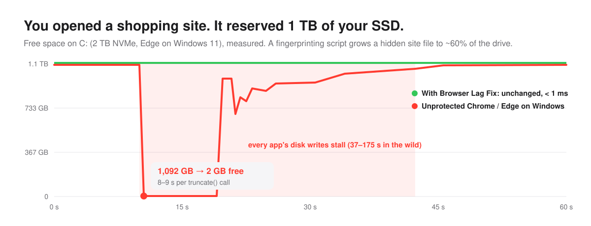

<div align="center">

# Browser Lag Fix

### Your PC isn't slow. A website just reserved a terabyte of your SSD.

**Stop Chrome and Edge from freezing Windows.** Some shopping sites run anti-bot and fingerprinting scripts that make your
browser reserve **~60% of your drive** for a few seconds. Windows then rescans the whole disk and
**every app's disk writes stall for 30 seconds to 3 minutes.** This fixes it.

[](https://github.com/leopck/browser-lag-fix/actions/workflows/ci.yml)
[](https://github.com/leopck/browser-lag-fix/releases)
[](LICENSE)




[**Install in 60 seconds**](#install-in-60-seconds) · [Am I affected?](#am-i-affected) · [How it works](#how-it-works) · [The investigation](docs/root-cause.md) · [Report to Chromium](docs/chromium-bug-report.md)

</div>

---

## The 30-second version

1. A site's script calls `FileSystemWritableFileStream.truncate()` on a file in the browser's private site storage (OPFS) with a giant size (8 TiB, 4 TiB, 2 TiB, 1 TiB …), binary-searching for the largest one the browser accepts.
2. Chromium allows up to ~60% of the drive, so on a 2 TB SSD the **1 TB** request succeeds.
3. On Windows, Chromium extends the file with `SetEndOfFile`, and **NTFS really reserves 1 TB**, not sparsely.
4. Your drive is now almost full. NTFS scans the entire free-space bitmap, and **every write on the system waits.** Your mouse moves, but apps hang, browsers freeze, and games stutter.
5. The script deletes the file and moves on. A few seconds later free space is back, and nothing in Task Manager explains what happened.

The script also learns your **disk size** from the answer, a fingerprinting signal.

## Am I affected?

Probably, if **all** of these are true:

- ✅ You use **Chrome, Edge, Brave, Vivaldi or Opera** on **Windows**
- ✅ Your system drive is **large** (bigger drive → bigger reservation → longer freeze)
- ✅ You get **random freezes** that Task Manager can't explain, often right after opening a retail site

**Check in 20 seconds:** Event Viewer → *Applications and Services Logs → Microsoft → Windows → Ntfs → Operational*. If you see **Event 147, "An IO took more than 30000 ms to complete"**, you've been hit.

| Platform | Freezes? | Why |
|---|---|---|
| Chrome / Edge on **Windows** | **Yes** | NTFS reserves the full size immediately (measured) |
| Chrome / Safari on **macOS, iOS** | Unlikely | APFS allocates unwritten space sparsely (not tested here); the quota still leaks |
| **Firefox**, any OS | No | Best-effort storage is capped at 10 GiB per site |

## Install in 60 seconds

### 1. Browser extension (everyone)

1. Download `browser-lag-fix-<version>.zip` from [**Releases**](https://github.com/leopck/browser-lag-fix/releases) and unzip it.
2. Open `edge://extensions` or `chrome://extensions` and turn on **Developer mode**.
3. Click **Load unpacked** and pick the unzipped folder. Repeat for each browser profile.

**No restart needed.** Already-open tabs are protected immediately. Huge requests are refused with the
browser's own `QuotaExceededError`; normal sites never notice.

### 2. Windows volume isolation (optional, defence in depth)

Catches *any* source of the problem, including Web Workers that extensions can't see. Run in an **elevated** PowerShell with the browsers **closed**:

```powershell
Import-Module .\windows\BrowserLagFix.Volume
Install-BrowserLagFixVolume -Browser Edge, Chrome   # 20 GB virtual disk at C:\BrowserLagFix
Get-BrowserLagFixStatus
```

Undo at any time with `Uninstall-BrowserLagFixVolume`; your data is moved back. [Details](windows/README.md).

## Proof

Same probe page, same machine (Edge 158, Windows 11, 2 TB NVMe). [Full method and traces](docs/root-cause.md#controlled-reproduction).

| | Unprotected | Volume isolation | Extension |
|---|---|---|---|
| Largest file the page could create | **1,090 GiB** | 18 GiB | 10 GiB (cap) |
| C: free space during the probe | 1,092 → **2 GB** | unchanged | unchanged |
| Time per large `truncate()` | **8–9 s** | 4–34 ms | < 1 ms |
| Disk size the site learns | ~1.9 TB | ~1.9 TB | nothing (sees 10 GiB) |

Reproduce it yourself with `python repro/serve.py`, then open the printed URL. ⚠️ On an unprotected PC this really does fill the drive for a few seconds, so save your work first, or add `?start=64` for a harmless test capped at 64 GiB. See [repro/](repro/).

## How it works

```
 Site script                         Browser (Windows)                      Disk
 ───────────                         ─────────────────                      ────
 writable.truncate(1023 GiB)  ──►    quota check: 60% of drive → OK  ──►    NTFS reserves 1.1 TB
                                     SetEndOfFile() on                      → drive ~full
                                     …\File System\NNN\t\00\000000xx        → bitmap scan, writes stall

 With the extension:   truncate(1023 GiB) ──► refused in the page: QuotaExceededError (cap 10 GiB)
 With the volume:      SetEndOfFile() lands on a 20 GB virtual disk ──► fails fast, C: untouched
```

| | What it does | Protects against | Needs |
|---|---|---|---|
| [**Extension**](extension/) | Refuses page requests to grow a site file beyond a cap (default 10 GiB) | Freezes **and** the disk-size leak, on any site, whatever the script | Chrome / Edge / Brave 111+ |
| [**Volume isolation**](windows/) | Moves each profile's site file storage onto a small virtual disk | Freezes from **any** source | Windows 10/11, admin |
| [**Reproduction**](repro/) | A 60-line page that triggers the problem on demand | Verifying the bug and the fixes | Python 3 |
| [**Diagnostics**](diagnostics/) | Free-space dip detector + WPR flight-recorder profile | Proving it on *your* machine | Windows, admin |

## FAQ

**Is this malware?** The scripts we saw look like commercial bot-detection or fingerprinting code that measures the storage quota. The freeze is a side effect of how Chromium implements the request on Windows.

**Will it break sites?** Requests under the cap (10 GiB by default, the same quota Chromium already *reports* through `navigator.storage.estimate()`) pass through untouched. Sites that genuinely need more, such as offline video editors, can be allowed from the popup.

**Does it read my browsing?** No. It runs locally, makes no network requests, and stores only counters plus, optionally, the last 500 refused requests on your machine. See [PRIVACY.md](PRIVACY.md).

**Why not just block the script?** It's obfuscated, injected through `eval`, served from different domains, and changes over time. Both fixes target the **behaviour**, not a script.

**Is there a real fix?** Yes, in the browser: extend files sparsely on Windows and bound growth by actual free space. We've written it up for Chromium: [docs/chromium-bug-report.md](docs/chromium-bug-report.md).

## Repository layout

```
extension/     MV3 browser extension (guard, settings UI, icons)
windows/       BrowserLagFix.Volume PowerShell module
repro/         probe.html + local server to reproduce the issue
diagnostics/   WPR profile and free-space dip watcher
docs/          root-cause analysis, upstream bug report, threat model
tests/         Node tests (extension), Pester tests (module), real-browser end-to-end test
tools/         code generation, icon rendering, packaging
```

## Development

```bash
npm ci
npm run ci          # generated-file check, ESLint, unit tests, package -> dist/
```

```powershell
Invoke-Pester tests/windows -Output Detailed                         # unit tests
Invoke-Pester tests/windows -Output Detailed -TagFilter Integration  # elevated: real VHDX lifecycle
pwsh tests/e2e/Invoke-ExtensionE2E.ps1                               # real Edge, throwaway profile
```

See [CONTRIBUTING.md](CONTRIBUTING.md). Security issues: [SECURITY.md](SECURITY.md).

---

<div align="center">

**If this explained your mystery freezes, please ⭐ the repo and share it.** That's how others find it.

Made by [@leopck](https://github.com/leopck). Also by the same author: [**Glide**](https://github.com/leopck/glide-fullscreen), macOS-smooth fullscreen animations for Chrome and Edge on Windows.

[MIT License](LICENSE)

</div>
